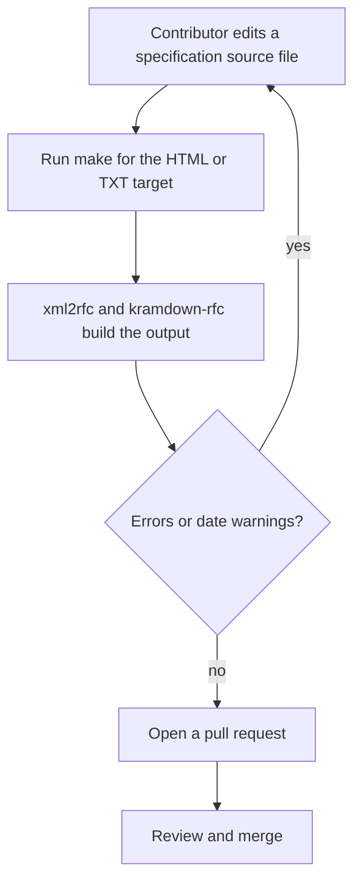

# Deep Dive: openid/sharedsignals

> 一言で言うと: Shared Signals ワーキンググループが SSF、CAEP、RISC、CAEP Interoperability Profile を開発する OpenID Foundation のリポジトリであり、現在 SSF 1.1 と CAEP 1.1 の草案が進行中である。

## 概要

README はワーキンググループの目標を、関連または依存するシステム間でセキュリティイベント、状態変化、その他のシグナルを共有することと述べている。目的は三つ挙げられている。分散サービス全体でアクセスを管理しアクセス制御を実施すること、侵害されたアカウント、デバイス、サービスその他のプリンシパルを悪用して攻撃者がさらに別のシステムへ到達するのを防ぐこと、ユーザー、管理者、サービスプロバイダーがインシデントの検知と対応で連携できるようにすることである。リポジトリは開発中の仕様と、公開済みの 1.0 Final Specifications を保持している。各仕様は個別にバージョン管理され、固有の変更がある場合にのみ新しいフォルダーが作られ、RISC は 1.0 のままである。投入された資料は README と最近更新されたプルリクエストの一覧のみであるため、本稿は個々の仕様の規範的な本文ではなく、リポジトリとその活動を扱う。

## 仕組み

1. 貢献者が仕様のソースファイルのいずれかを変更する。README は「xml files」と述べるが例では `foo.md` を使っており、正確なソース形式は資料からは分からない。
2. 貢献者は `make` を実行する。例は `make foo.html` や `make foo.txt` である。
3. ビルドには `xml2rfc`（pip でインストール）と `kramdown-rfc`（Ruby gem としてインストール）が必要である。
4. 貢献者は生成エラーを修正し、`make` が日付について警告した場合は文書の日付を更新する。
5. README によれば、生成された HTML と TXT のファイルはリポジトリにアップロードされない。`make` の実行は、変更が生成を壊さないことの確認にすぎない。
6. 変更はプルリクエストとして提出される。一覧にはマージ済みのものと未マージのものがあるが、資料にレビュー規則の記述はない。

## ユースケース

- Transmitter または Receiver の実装者が、SSF 1.1 の現行草案を公開済みの SSF 1.0 と比較し、何が変わるのかを確認する。
- CAEP 連携に取り組む導入者が、CAEP Interoperability Profile を読む。そのプルリクエストは Receiver 要件、デバイスコンプライアンス変更、リスクレベル変更のユースケースを扱っている。
- 既存の SSF 1.0、CAEP 1.0、RISC 1.0 の運用者が、保持されている Final Specifications を確認する。README によれば、正誤表の更新はこれらに適用される。
- ワーキンググループへの貢献者が、複合サブジェクト、署名アルゴリズムのネゴシエーション、CORS などの未マージのプルリクエストを追い、次の草案の前に議論に加わる。

## なぜ今重要か

- **Trigger**: `subject.json` には選定理由がない（`ai_note` は空である）。`insights.md` の以前の概要は、マージされたコミット "Drop event signatures (#368)" を挙げていた。
- **Source evidence**: README は #368 "Drop event signatures" をクローズかつマージ済み、#310 "Create 1.1 draft documents from 1.0, retaining 1.0" をマージ済みとして挙げ、#355 "Add SET signing algorithm negotiation to SSF" などをオープンとして挙げている。#356 "Issue #350 - dropping algo strictness" はクローズとのみ記載されている。
- **Expected impact**: #368 の差分は資料にないため、その影響は未検証である。SSF 1.1 から署名の選択肢が削除されるのであれば、実装者は #355 で提案されている SET 署名ネゴシエーションとの関係を確認する必要がある。これは推測であり、資料が述べていることではない。

## 変更点

- Spec/document change summary: 差分は投入されていない。タイトルのみから分かる範囲では、1.0 を保持したまま 1.0 から作られた SSF 1.1 と CAEP 1.1 の開発草案（#310、#309）、削除されたイベント署名（#368）、OIDF レビュー用の Draft-01 を持つ CAEP Interoperability Profile（#343）、Receiver 要件の追加（#315）、リスクレベル変更のユースケース（#349）がある。未マージの提案には、Event Subjects の複合サブジェクト（#366）、サブジェクトまたはプリンシパルとしてのエージェントとワークロード（#362）、任意のストリーム設定における JSON null の扱い（#369）、Transmitter メタデータと JWK Set への CORS 推奨（#367）、デバイスコンプライアンス変更シグナルへのデバイス管理状態オプション（#329）がある。
- Compatibility or migration concerns: 資料に記述はない。1.0 の文書は保持され 1.1 は新しいフォルダーであるため、両バージョンは共存する。1.1 が 1.0 と後方互換かどうか、イベント署名の削除が 1.0 の Receiver にとって何を意味するかは示されていない。

## 技術分析

- Threat model implications: 掲げられた目標は、一つのプリンシパルを侵害した攻撃者が他のシステムへ到達するのを防ぐことであり、共有されるシグナルの完全性と真正性が中心になる。"Drop event signatures"（#368）というタイトルはこの領域に関わるが、何が削除され、代わりに何がイベントを保護するのかを資料は述べていないため、結論は出さない。
- Protocol flow implications: README はプロトコル自体を説明していない。プルリクエストのタイトルには Transmitter メタデータ、ストリーム設定、Event Subjects、ステータスエンドポイント（#314）が現れ、Transmitter と Receiver のストリームモデルを示唆するが、資料はそれを規定していない。
- Interop concerns: 署名アルゴリズムのネゴシエーション（#355）と "dropping algo strictness"（#356）は、Receiver がどのアルゴリズムを受け入れなければならないかが未解決であることを示している。CAEP Interoperability Profile のプルリクエスト（#315、#313、#325）は、Receiver、スコープ、OAuth に関するプロファイル要件を示している。詳細には仕様本文が必要である。

## 未解決の問題

- #368 は正確に何を削除するのか。SET の形式や Transmitter と Receiver の要件は変わるのか。資料にはタイトルしかない。
- #368 の後も #355 は意図されているのか。クローズされた #356 とはどう関係するのか。
- 複合サブジェクト（#366）とエージェントまたはワークロードのサブジェクト（#362）は、1.0 の Receiver を壊す形でサブジェクトのモデルを変えるのか。
- README はソースファイルを xml と述べるが例は `foo.md` である。現在の形式はどちらか。
- 古いプルリクエスト（#120、#248、#283、#314）は未マージのままである。1.1 に含める予定かどうかは資料に示されていない。

## 実験

- [ ] Lab 1: リポジトリをクローンし、`xml2rfc` と `kramdown-rfc` をインストールして SSF 1.1 の HTML と TXT のターゲットに対して `make` を実行し、出力を公開済みの SSF 1.0 の文書と比較する。
- [ ] Lab 2: #368 の差分を読み、変更されるすべての規範的記述を列挙し、1.0 の実装が採用する必要のある Receiver の挙動を書き出す。
- [ ] Lab 3: Transmitter と Receiver のテスト用の組を構築し、同じイベントを署名ありと署名なしで送って、署名なしの形式を拒否する 1.0 の実装を確認する。

## 出典

- <https://github.com/openid/sharedsignals>
- <https://openid.net/wg/sharedsignals/>
- <https://openid.github.io/sharedsignals/SSF_1.1/openid-sharedsignals-framework-1_1.html>
