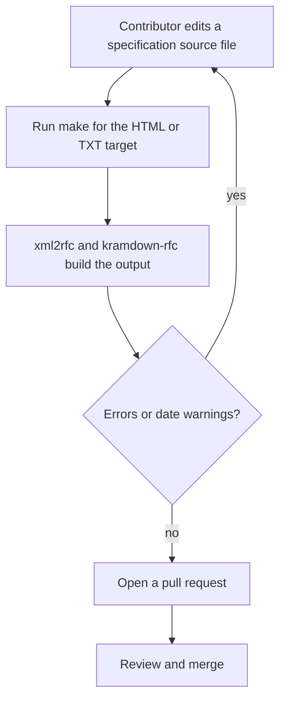

# Deep Dive: openid/sharedsignals

> In one line: the OpenID Foundation repository where the Shared Signals Working Group develops SSF, CAEP, RISC and the CAEP Interoperability Profile, with SSF 1.1 and CAEP 1.1 drafts now under way.

## What this is

The README states the Working Group's goal: to share security events, state changes and other signals between related or dependent systems. It names three aims: managing access and enforcing access control across distributed services, preventing attackers from using a compromised account, device, service or other principal to reach further systems, and letting users, administrators and service providers coordinate on detecting and responding to incidents. The repository keeps the specifications under development and the published 1.0 Final Specifications. Each specification is versioned independently, so it only gets a new folder once it has changes of its own, and RISC remains at 1.0. The staged material is only the README and a list of recently updated pull requests, so this deep dive describes the repository and its activity, not the normative text of any specification.

## How it works

1. A contributor changes one of the specification source files. The README says "xml files" but its example uses `foo.md`, so the exact source format is not clear from the material.
2. The contributor runs `make`, for example `make foo.html` or `make foo.txt`.
3. The build needs `xml2rfc` (installed with pip) and `kramdown-rfc` (installed as a Ruby gem).
4. The contributor fixes any generation errors and updates the document date if `make` warns about it.
5. The README says the generated HTML and TXT files are not uploaded to the repository: running `make` only checks that the change does not break generation.
6. The change goes in as a pull request. The list shows both merged and open ones; the material does not describe the review rules.

## Use cases

- An implementer of a Transmitter or Receiver checks the current draft of SSF 1.1 against the published SSF 1.0 to see what is changing.
- A deployer working on a CAEP integration reads the CAEP Interoperability Profile, whose pull requests cover Receiver requirements, device compliance changes and a risk level change use case.
- A maintainer of an existing SSF 1.0, CAEP 1.0 or RISC 1.0 deployment looks at the retained Final Specifications, which the README says are where errata updates are applied.
- A contributor to the Working Group follows open pull requests, such as those on complex subjects, signing algorithm negotiation and CORS, to take part in the discussion before the next draft.

## Why This Matters Now

- **Trigger**: `subject.json` gives no reason for the pick (`ai_note` is empty). An earlier briefing in `insights.md` noted the merged commit "Drop event signatures (#368)".
- **Source evidence**: the README lists #368 "Drop event signatures" as closed and merged, #310 "Create 1.1 draft documents from 1.0, retaining 1.0" as merged, and open pull requests such as #355 "Add SET signing algorithm negotiation to SSF". #356 "Issue #350 - dropping algo strictness" is listed as closed only.
- **Expected impact**: the material gives no diff for #368, so its effect is unverified. If it removes a signing option from SSF 1.1, implementers would need to check how that interacts with the SET signing negotiation proposed in #355. This is an inference, not something the material states.

## What Changed

- Spec/document change summary: no diff is staged. From titles only, the repository now has SSF 1.1 and CAEP 1.1 development drafts created from 1.0 while retaining 1.0 (#310, #309), event signatures dropped (#368), and a CAEP Interoperability Profile with a Draft-01 for OIDF Review (#343), a Receiver requirements addition (#315) and a risk level change use case (#349). Open proposals include complex subjects in Event Subjects (#366), agent and workload as subject or principal (#362), JSON null handling for optional stream configuration (#369), CORS recommendation for Transmitter metadata and JWK Set (#367), and a device management status option in device compliance change (#329).
- Compatibility or migration concerns: the material states none. Because 1.0 documents are retained and 1.1 is a new folder, the two versions coexist. Whether 1.1 is backward compatible with 1.0, and what dropping event signatures means for 1.0 Receivers, is not shown.

## Technical Analysis

- Threat model implications: the stated goal is to stop an attacker who compromises one principal from reaching other systems, so the integrity and authenticity of shared signals are central. The title "Drop event signatures" (#368) touches that area, but the material does not say what is dropped or what protects the event instead, so no conclusion is drawn.
- Protocol flow implications: the README does not describe the protocol itself. The pull request titles mention Transmitter metadata, stream configuration, Event Subjects and a status endpoint (#314), which suggest a Transmitter and Receiver stream model, but the material does not specify it.
- Interop concerns: signing algorithm negotiation (#355) and "dropping algo strictness" (#356) point to open questions about which algorithms Receivers must accept. The CAEP Interoperability Profile pull requests (#315, #313, #325) indicate profile requirements for Receivers, scopes and OAuth. Details need the specification text.

## Open Questions

- What exactly does #368 remove, and does it change the SET format or the Transmitter and Receiver requirements? The material gives only the title.
- Is #355 still intended after #368, and how does it relate to the closed #356?
- Will complex subjects (#366) and agent or workload subjects (#362) change the subject model in a way that breaks 1.0 Receivers?
- The README says source files are xml but its example is `foo.md`: which format is current?
- Several older pull requests (#120, #248, #283, #314) are still open. The material does not say whether they are planned for 1.1.

## Experiments

- [ ] Lab 1: Clone the repository, install `xml2rfc` and `kramdown-rfc`, run `make` for the SSF 1.1 HTML and TXT targets, and compare the output with the published SSF 1.0 documents.
- [ ] Lab 2: Read the diff of #368 and list every normative statement that changes, then write the Receiver behavior a 1.0 implementation would need to adopt.
- [ ] Lab 3: Build a Transmitter and Receiver test pair and send the same event with and without a signature to see which 1.0 implementations reject the unsigned form.

## Sources

- <https://github.com/openid/sharedsignals>
- <https://openid.net/wg/sharedsignals/>
- <https://openid.github.io/sharedsignals/SSF_1.1/openid-sharedsignals-framework-1_1.html>
