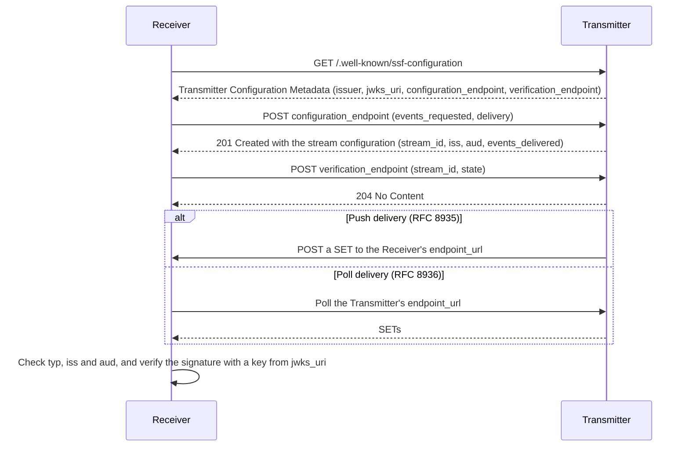

# Deep Dive: OpenID Shared Signals (openid/sharedsignals)

> In one line: the Shared Signals Working Group's repository for SSF, CAEP and RISC (OpenID Final Specifications since September 2025) and the draft CAEP Interoperability Profile; the SSF 1.1 and CAEP 1.1 drafts created on 13 November 2026 do not yet change any SSF rule, and on 17 November 2026 #368 removed the profile's only event-signing rule (RS256, 2048-bit keys).

## What this is

The README states the Working Group's goal: to share security events, state changes and other signals between related or dependent systems, in order to manage access across distributed services, stop attackers from using one compromised account, device or other principal to reach further systems, and let users, administrators and service providers coordinate on incidents.

The repository (commit `d8f89ab`, 17 November 2026) holds:

- `SSF_1.0/`, `CAEP_1.0/`, `RISC_1.0/`: the 1.0 texts. The OpenID Foundation announced on 2 September 2025 that all three were approved as OpenID Final Specifications; the published documents are dated 29 August 2025. The README says these are the documents that errata are applied to.
- `SSF_1.1/`, `CAEP_1.1/`: development drafts created from 1.0 by #310 (merged 13 November 2026). Each specification is versioned on its own, so RISC has no 1.1 folder.
- `openid-caep-interoperability-profile-1_0.md`: the CAEP Interoperability Profile 1.0, titled "draft 01". #343 (21 July 2026) prepared Draft-01 for the OIDF member 45-day review. Its Document History already has a "-02" list: the Risk Level Change use case and the removal of event signatures (#368).

SSF, CAEP and the profile are written in kramdown-rfc Markdown (`.md`). RISC 1.0 and three side documents (`oauth-event-types-1_0`, `openid-risc-use-cases`, `subject-identifier-scenarios`) are xml2rfc XML. The README's "update one of the xml files" therefore fits only RISC; the Makefile converts `.md` to `.xml` with `kramdown-rfc2629` and renders HTML and TXT with `xml2rfc`. The workflow `build-everything.yml` renders every document on pull requests and publishes them to GitHub Pages on pushes to `main`, which is why the README says the HTML and TXT files are not committed.

SSF itself is "a profile for Security Event Tokens" (RFC 8417). Its abstract says it directly profiles SET (RFC 8417), Subject Identifiers for SETs (RFC 9493), push delivery (RFC 8935) and poll delivery (RFC 8936). Its normative references also include JWT (RFC 7519) and JWK (RFC 7517), but not JWS (RFC 7515). CAEP and RISC define event types that travel in SSF SETs.

## How it works

Section numbers below are for SSF 1.0 Final. The SSF 1.1 draft at `d8f89ab` has the same text and numbering.

1. The Receiver fetches the Transmitter Configuration Metadata by inserting `/.well-known/ssf-configuration` into the Issuer URL (Section 7.2). `issuer` is REQUIRED and MUST equal the `iss` of the Transmitter's SETs. `jwks_uri` is OPTIONAL, but MUST be present if the Transmitter intends to sign JWTs (Section 7.1). Existing RISC Transmitters MAY keep `/.well-known/risc-configuration` (Section 7.2.2).
2. The Receiver MUST create an Event Stream before it receives events, with a POST to the Configuration Endpoint. The Transmitter answers `201 Created` with the stream configuration, and the Receiver MUST check that its `iss` matches the Issuer it discovered. If the request has no `delivery`, the Transmitter MUST assume poll delivery (Section 8.1.1.1). The Management API is OPTIONAL for Transmitters but RECOMMENDED, and its endpoints MUST use HTTP authentication and authorization unless another trust method exists (Section 8).
3. The Receiver can ask for a Verification Event with a POST to the Verification Endpoint, answered by `204 No Content`. The event's `sub_id` is an `opaque` identifier whose `id` is the `stream_id`. If the returned `state` does not match, the Receiver SHOULD return the `invalid_state` error (Section 8.1.4).
4. Events arrive by push to an `endpoint_url` the Receiver sets (Section 6.1.1) or by poll from an `endpoint_url` the Transmitter supplies (Section 6.1.2).
5. Every SSF SET MUST use explicit typing (`typ` `secevent+jwt`, Section 4.1.1). The `sub` and `exp` claims MUST NOT be present (Sections 4.1.2 and 4.1.7). `iss` MUST match the stream configuration, and Receivers MUST check it (Section 4.1.6). The signature key "can be obtained through" `jwks_uri` (Section 4.1.4). SSF does not require SETs to be signed and does not name a signing algorithm; the explicit-typing example header even shows `HS256`.

The CAEP Interoperability Profile narrows this for interoperability (section numbers from the draft rendered on 17 November 2026):

- Transmitter metadata MUST include `spec_version` (`1_0` or greater), `delivery_methods_supported`, `jwks_uri` serving the current signing keys, `configuration_endpoint`, `status_endpoint` and `verification_endpoint` (Sections 2.3.1 to 2.3.6).
- Receivers MUST get the Transmitter's signing keys from `jwks_uri` (Section 2.4.2), MUST use OAuth 2.0 for Stream Management API calls (Section 2.4.3), and MUST treat all subjects as implicitly added to a stream (Section 2.4.4).
- The subject formats `email`, `iss_sub` and `opaque` (Verification events only) MUST be supported (Section 2.5). The `events` claim MUST contain exactly one event (Section 2.7.1).
- The Authorization Server MUST support the scopes `ssf.manage` and `ssf.read` (Section 2.6.3), and MUST support the client credentials grant or the authorization code grant to issue access tokens that live no more than 60 minutes (Section 2.6.1).
- An implementation MUST support at least one of the use cases in Section 3: Session Revocation / Logout, Credential Change, Device Compliance Change, Risk Level Change.
- Since #368 the profile has no rule that events MUST be signed or with which algorithm.

## Use cases

The first item comes from the profile; the rest are illustrative reader scenarios, not text from the specifications.

- The profile's own use cases (Section 3): a Transmitter sends CAEP `session-revoked`, `credential-change`, `device-compliance-change` or `risk-level-change` events, and the Receiver ends sessions or re-evaluates access.
- Illustrative: an implementer of SSF 1.0 diffs the 1.1 draft against 1.0 to see whether 1.1 work affects them. At `d8f89ab` only the title and document name differ.
- Illustrative: a Receiver that hard-coded RS256 because the profile required it decides how to agree an algorithm with each Transmitter now that #368 removed that rule.
- Illustrative: a contributor follows the open 1.1 proposals (#355, #367, #369) and the profile proposals (#363, #366) before the next draft.

## Why This Matters Now

- **Trigger**: openid/sharedsignals was the highest-ranked `openid` candidate without a deep dive in `tracks/openid/data/normalized/candidates.json` (snapshot 2026-11-24, rank 3, score 14.4, behind OpenID4VCI and OpenID4VP). `tracks/openid/data/normalized/insights.json` recorded the merge of #368 "Drop event signatures".
- **Source evidence**: #310 created the 1.1 drafts (merged 13 November 2026). #368 (opened 16 November, merged 17 November 2026 with three approvals) says "As discussed on the 11/10 call, dropping the requirement for event signatures". It deletes the profile's section "All events MUST be signed using the `RS256` algorithm with a minimum of 2048-bit keys." The alternative #356, which would have kept a JWS signing requirement without fixing RS256, was closed unmerged on 16 November 2026. On 26 November 2026, 13 pull requests were open.
- **Expected impact**: a profile-conformant Transmitter is no longer tied to RS256, and the profile no longer says events must be signed at all, although it still requires `jwks_uri` to serve signing keys and Receivers to fetch them (Sections 2.3.3 and 2.4.2). Transmitters and Receivers now have to agree on signing outside the profile. #355 proposes an in-band algorithm negotiation for SSF 1.1; it is open and not part of any draft.

## What Changed

- Spec/document change summary:
  - #310 (merged 13 November 2026) moved the 1.0 texts unchanged into `SSF_1.0/`, `CAEP_1.0/` and `RISC_1.0/`, and copied SSF and CAEP into `SSF_1.1/` and `CAEP_1.1/`. At `d8f89ab`, SSF 1.1 differs from 1.0 only in its title and `docname` (the fixed date line was dropped so the build sets it). CAEP 1.1 also adds the base URI `https://schemas.openid.net/secevent/caep/event-type/v1.1` for events added or updated by 1.1, and says "This spec does not deprecate 1.0 events". An earlier attempt, #309 "Updated versions to 1.1 for next draft", was closed unmerged on 9 December 2025.
  - #368 (merged 17 November 2026) changes only the CAEP Interoperability Profile. It deletes the "Event Signatures" section (the RS256, 2048-bit rule) and adds a "-02" Document History line. SSF and CAEP are untouched.
  - #356 (closed unmerged 16 November 2026, for issue #350) would instead have required JWS signing per RFC 8417 Section 5.1, forbidden `none`, required a mutually supported algorithm agreed out of band, and kept 2048-bit RSA keys.
  - Profile changes merged during Draft-01: device compliance change (#313, 7 January 2026), Receiver requirements (#315, 17 February 2026), OAuth section (#325, 13 May 2026), Draft-01 for OIDF review (#343, 21 July 2026) and the Risk Level Change use case (#349, 1 September 2026).
- Open proposals on 26 November 2026 (none merged):

| PR | Target | Proposal |
| --- | --- | --- |
| #355 | SSF 1.1 | OPTIONAL Transmitter metadata `set_signing_alg_values_supported` (must not contain `none`) and a Receiver-supplied stream property `set_signing_alg`; Receivers MUST reject SETs whose `alg` differs; `400` for an unsupported value; adds RFC 7515 and RFC 7518 as normative references |
| #367 | SSF 1.1 | `ssf-configuration` and `jwks_uri` SHOULD support CORS; endpoints that need authorization SHOULD NOT allow cross-origin requests |
| #369 | SSF 1.1 | senders SHOULD omit unset OPTIONAL stream configuration properties instead of sending `null`; receivers MUST treat `null` as absent |
| #366 | Profile 2.5 | Complex Subject Members (SSF Section 3.3) built from `email` and `iss_sub` MUST also be supported |
| #363 | Profile 2.3.1 | metadata at `/.well-known/ssf-configuration` MUST carry `spec_version`; a Transmitter that also serves `1_0-ID1` Receivers MUST publish that metadata at `/.well-known/sse-configuration` |
| #362 | SSF and CAEP | `agent` and `workload` members for complex subjects, and AGENT and WORKLOAD principals for `risk-level-change`; written against the root-level 1.0 files that #310 moved, so GitHub reports a conflict |
| #329 | CAEP 1.1 | an `unmanaged` value for device compliance change; changes requested |

- Compatibility or migration concerns: because SSF 1.1 currently equals 1.0, nothing in 1.1 breaks a 1.0 implementation yet. Neither the README nor the drafts state a compatibility policy for 1.1. CAEP 1.1 keeps 1.0 event types valid. The profile still references SSF 1.0 Final and CAEP 1.0, not the 1.1 drafts.

## Technical Analysis

- Threat model implications: SET integrity rests on signatures, but SSF leaves signing to the deployment (`jwks_uri` is only required "if the Transmitter intends to generate signed JWTs", Section 7.1). The profile's RS256 rule was the one place in this repository that fixed an algorithm, and it is gone. The security considerations proposed in #355 note that a Receiver accepting any algorithm its JWT library supports is exposed to algorithm substitution. Until something like #355 lands, the Receiver's algorithm allow-list is a deployment decision.
- Protocol flow implications: the 1.1 drafts do not change the flow. If #355 merges as proposed, stream creation gains `set_signing_alg`, the Transmitter must pick and return an algorithm when the Receiver omits it, and after a change the Receiver MAY accept the old algorithm for a bounded period it chooses.
- Interop concerns: the profile still requires `status_endpoint` (Section 2.3.5) while the open #314 would remove that requirement. Subject support is `email`, `iss_sub` and `opaque` today; #366 would add complex subjects. #363 would split SSF 1.0 and `1_0-ID1` metadata between two well-known paths.

## Open Questions

- After #368, does the WG mean the profile to require signed events at all? It still requires signing keys through `jwks_uri` (Sections 2.3.3 and 2.4.2). The reasoning is in the 10 November 2026 call, not in the pull request.
- Will #355 land in SSF 1.1, and will a later profile draft point to SSF 1.1?
- What compatibility policy will SSF 1.1 have once it diverges from 1.0? Nothing states one yet.
- Will #362 be rebased onto `SSF_1.1/` and `CAEP_1.1/`, given that the Final 1.0 texts only take errata?
- The Makefile's `all` target still names a `1.1/` folder that #310 did not create (`1.1/openid-risc-1_1.html` and others), while the workflow names each file. Is `all` still maintained?

## Experiments

- [ ] Lab 1: Clone the repository, install `xml2rfc` and `kramdown-rfc`, run `make SSF_1.1/openid-sharedsignals-framework-1_1.html` and `make SSF_1.0/openid-sharedsignals-framework-1_0.html`, and diff the outputs. Expected from the sources: only the title and document name differ.
- [ ] Lab 2: Build SSF 1.1 from the head of #355 and walk Create Stream with and without `set_signing_alg`, and with an unsupported value, against the error table in Section 8.1.1.1.
- [ ] Lab 3 (illustrative, not from the specifications): Build a Transmitter and Receiver pair and send the same SET signed with RS256, ES256 and unsigned, to see which Receivers accept each now that the profile no longer fixes RS256.

## Sources

- <https://github.com/openid/sharedsignals> (commit `d8f89ab`)
- <https://openid.net/specs/openid-sharedsignals-framework-1_0-final.html>
- <https://openid.net/specs/openid-caep-1_0-final.html>
- <https://openid.net/specs/openid-risc-1_0-final.html>
- <https://openid.net/three-shared-signals-final-specifications-approved/>
- <https://openid.github.io/sharedsignals/SSF_1.1/openid-sharedsignals-framework-1_1.html>
- <https://openid.github.io/sharedsignals/openid-caep-interoperability-profile-1_0.html>
- <https://github.com/openid/sharedsignals/pull/310>
- <https://github.com/openid/sharedsignals/pull/355>
- <https://github.com/openid/sharedsignals/pull/356>
- <https://github.com/openid/sharedsignals/pull/368>
- <https://openid.net/wg/sharedsignals/>
